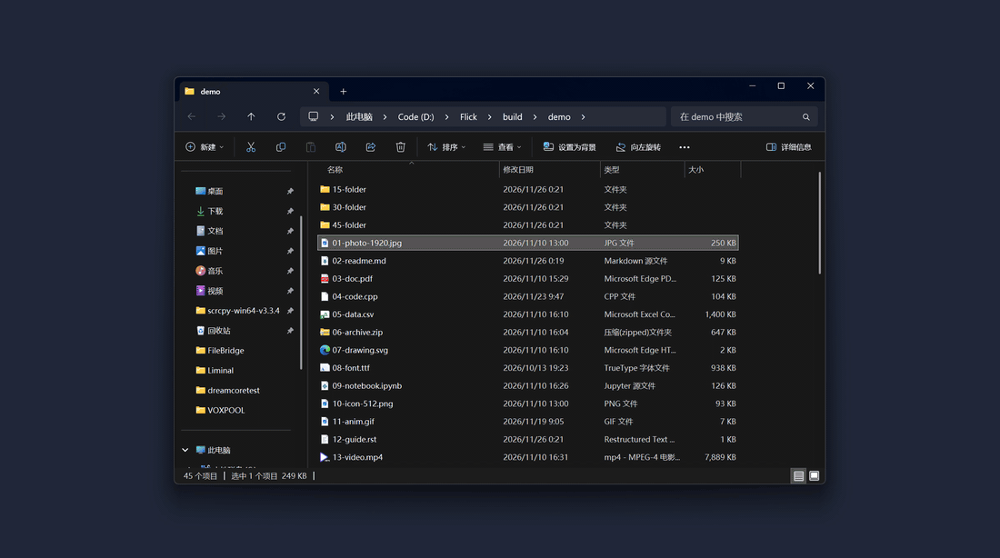

# Flick

Quick Look for Windows 11. Select a file in Explorer, press **Space**: it's on screen in ~10 ms.

Code, Markdown, images, PDF, video, audio, CSV, archives, folders, fonts, programs.
Native C++, ~25 MB RAM, no dependencies.

**[Download Flick.exe](https://github.com/Dan-k391/Flick/releases/latest)**, run it, press Space.
Arrows move between files, Space/Esc closes.

## Build

Visual Studio 2022+ (C++ desktop): `build.cmd` → `build\Release\Flick.exe`. See [AGENTS.md](AGENTS.md).

Uses [Scintilla/Lexilla](https://www.scintilla.org/), [md4c](https://github.com/mity/md4c),
[lunasvg](https://github.com/sammycage/lunasvg); licenses in `third_party/`.
